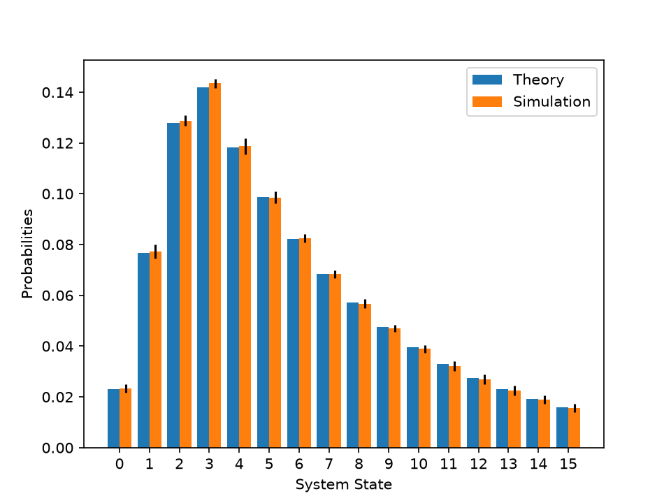

# queueing-mmsn

Exact analysis of the M/M/s/N queue in Python: stationary distribution
and performance measures (blocking probability, L, Lq, W, Wq), with tests.

## Usage

    from queueing.analytical import performance_measures
    performance_measures(lam=1, mu=2, s=1, N=2)

## Staffing optimization

 Cost per unit time = s * c_server + Lq * c_wait + lam * P_block * c_loss.
 Parameters: lam = 10, mu = 3, N = 15, c_server = 20, c_wait = 5, c_loss = 50.

 [Cost vs servers](figures/costs_over_servers_graph.png)
  The minimum cost is reached at s = 4. With fewer servers, the offered load
  (lam/mu ≈ 3.33) exceeds the service capacity s*mu, so many customers are rejected
  and the loss term dominates the cost. With more servers, waiting and blocking
  vanish and the cost is driven only by the staffing term s * c_server, which makes
  the curve a straight line of slope c_server = 20. The optimum is shallow: s = 5
  costs only slightly more than s = 4.

## Validation by simulation

 

 Discrete-event simulation of an M/M/4/15 queue (lam = 10, mu = 3), 10 runs of
 50,000 customers each. Bars show the stationary distribution; error bars are
 the standard deviation across runs. 
 
 The two distributions agree closely: the largest gap over the 16 states is 0.0014,
 and the blocking probability is 0.0154 +/- 0.0017 in simulation against 0.0159 in
 theory, a difference well within the run-to-run variability. This cross-checks the
 analytical formulas and the simulator against each other.

## Tests

    pip install -e ".[dev]"
    pytest

## Roadmap
- [x] Analytical module
- [x] Staffing cost optimization
- [x] Discrete-event simulation and validation against theory